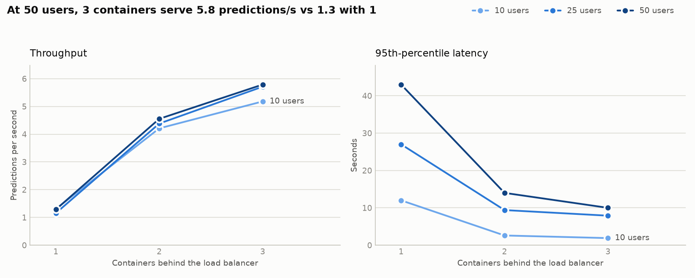

# Diabetic Retinopathy Detection — MLOps Deployment

A web application that grades retinal fundus images for diabetic retinopathy
(DR) across five severity levels, accepts new labelled images from the field,
and **retrains the model on demand** using the existing model as a pre-trained
base. Built to support scalable, accessible DR screening across Africa, where
specialist ophthalmologists are scarce.

### 🔗 Links

| | |
|---|---|
| **Live app** | https://dr-detection-mlops-69ui.onrender.com |
| **Video demo** | https://youtu.be/5iXWeM2hiyc |
| **Notebook** | [`notebook/diabetic_retinopathy_detection.ipynb`](notebook/diabetic_retinopathy_detection.ipynb) |

> ⚠️ Clinical screening aid only — not a substitute for professional diagnosis.
> The live app sleeps when idle (free tier); the first request after inactivity
> can take 30–60 s to wake.

---

## Features

- **Predict** — upload a fundus image and get its DR grade (0–4) with per-class
  confidence and a clinical action note.
- **Bulk upload** — add many labelled images at once (one grade per batch), or
  a ZIP with a folder per grade (`0/` … `4/`). Each image is checked and saved to
  the database, into either the **training pool** (used for retraining) or the
  held-out **evaluation set** (used to measure models, never trained on). Bad files
  are listed with the reason; the rest are kept.
- **Retrain on demand** — one button fine-tunes a new model version from the
  training pool, using the served model as the pre-trained base with its
  convolutional backbone frozen, so it runs on a CPU. Each stage and the
  epoch-by-epoch metrics show live.
- **Evaluation gate** — the new model and the served model are scored on the same
  held-out images, and the new one is promoted only if it is not worse. Every
  version is kept, and **the original weights are never overwritten.**
- **Rollback** — activate any earlier model version with one click.
- **Uptime and status** — a pill on every page shows whether the model is up,
  for how long, and which version is serving (`/health`). The Insights page adds
  requests and predictions served, errors and prediction latency (`/api/status`).
- **Insights** — four dataset features charted by grade, each with a written
  interpretation, plus the class balance, the deployed model's held-out metrics
  and every model version with its metrics and promotion decision.
- **Scales out** — `docker compose` puts an nginx load balancer in front of any
  number of app containers. A Locust flood test measured 1, 2 and 3 containers.

---

## Grade scale

| Grade | Label | Clinical action |
|------:|-------|-----------------|
| 0 | No DR | Routine annual screening |
| 1 | Mild DR | Re-screen in 6–12 months |
| 2 | Moderate DR | Specialist review within 3–6 months |
| 3 | Severe DR | URGENT specialist referral |
| 4 | Proliferative DR | IMMEDIATE ophthalmologist referral |

---

## Architecture

```
           Browser: Jinja2 pages + Chart.js
                         │ HTTP
                         ▼
           ┌──────────────────────────────┐   docker compose only; Render
           │ nginx load balancer (lb)     │   runs one container, no nginx
           │ round-robin                  │
           └────────┬─────────┬─────────┬─┘
                    ▼         ▼         ▼
  ┌────────────────────────────────────────────────────────────────┐
  │ web replicas 1…N: FastAPI + Uvicorn, 1 CPU each                │
  │                                                                │
  │ routes    pages · predict · upload · retrain · rollback ·      │
  │           insights · status                                    │
  │ services  model_service (lock, hot-swap, admission control)    │
  │           retrain_service · promotion (the gate) · registry    │
  │           pool (training vs evaluation) · monitor (uptime)     │
  │ src/      preprocessing · model · prediction                   │
  │           (also imported by the notebook's Section 14)         │
  └──────┬───────────────────┬───────────────────┬─────────────────┘
         ▼                   ▼                   ▼
  models/ (volume)     data/app.db (SQLite)  data/ (volume)
  exp5_base.keras      one row per image:    train/    replay buffer
  exp5_current.keras   path, grade, pool     test/     evaluation set
  versions/*.keras     (seed / user / eval)  uploads/  user images
  model_registry.json
```

- **Backend:** FastAPI + Uvicorn
- **Model runtime:** TensorFlow 2.18 (Keras 3), thread-safe reload under a lock
- **Database:** SQLite via SQLAlchemy
- **Frontend:** Jinja2 server-side templates + Chart.js (no build step)
- **Image processing:** OpenCV (headless) + NumPy
- **Containers:** Docker + docker compose, nginx load balancer
- **Load testing:** Locust
- **Hosting:** Render (Docker runtime)

### API

Interactive documentation is served at `/docs`.

| Method | Path | What it does |
|---|---|---|
| GET | `/`, `/predict`, `/upload`, `/retrain`, `/insights` | The web pages |
| POST | `/api/predict` | One image in; grade, label, per-class probabilities and clinical note out |
| POST | `/api/upload` | One labelled image, into the training pool or the evaluation set |
| POST | `/api/upload/bulk` | Many images with one grade |
| POST | `/api/upload/zip` | A ZIP with a folder per grade |
| POST | `/api/retrain` | Start retraining (409 if one is running, 503 if switched off) |
| GET | `/api/retrain/status` | Live stage, epoch metrics and the result |
| GET | `/api/retrain/readiness` | Pool sizes, the retraining trigger and the promotion rule |
| POST | `/api/rollback/{version}` | Make a saved version the active model |
| GET | `/api/insights` | Dataset features, metrics and the version history |
| GET | `/health` | Up or down, uptime, active version |
| GET | `/api/status` | Serving counters and prediction latency |

---

## Local setup

```bash
git clone https://github.com/Hassan-Adelani-Luqman/dr-detection-mlops.git
cd dr-detection-mlops
```

### With Docker (recommended — matches production)

```bash
docker compose up --build
# open http://localhost:8000        (APP_PORT=8080 docker compose up ... if 8000 is taken)
```

Compose runs an **nginx load balancer** (`lb`) in front of the app (`web`). To
scale out:

```bash
docker compose up -d --scale web=3
docker compose restart lb            # nginx picks up the new replicas
```

Each replica is limited to one CPU (`WEB_CPUS`, default 1.0) with single-threaded
TensorFlow, so every extra container adds one CPU of inference capacity. Every
response carries an `X-Served-By` header naming the container that served it.
Replicas share the `./models` and `./data` volumes (uploads, the database, the
registry and retrained versions persist across restarts) and stay on the same
model version: each checks the registry before predicting and reloads if another
replica retrained or rolled back. **Retrain with a single replica**: retraining
progress is held in the memory of the replica that runs it, so with several
replicas the status page may poll a different one.

### Without Docker

```bash
python -m venv .venv
# Windows: .\.venv\Scripts\Activate.ps1   |   Unix: source .venv/bin/activate
pip install -r requirements-dev.txt      # runtime + tests, Locust, notebook tools
uvicorn app.main:app --reload
# open http://localhost:8000
```

### Getting the data (needed for retraining and evaluation)

Prediction works out of the box. Retraining and the evaluation scripts need the
APTOS 2019 images, which cannot be redistributed:

1. Accept the competition rules at
   <https://www.kaggle.com/competitions/aptos2019-blindness-detection>.
2. Download and unzip into `data/raw/` (so that `data/raw/train.csv` and
   `data/raw/train_images/` exist), for example with the Kaggle CLI:
   `kaggle competitions download -c aptos2019-blindness-detection -p data/raw`.
3. Build the replay buffer and the held-out evaluation set, re-measure the model,
   and pick demo images it grades correctly:

```bash
python -m scripts.prepare_data          # data/train (200) + data/test (550)
python -m scripts.evaluate_model        # -> models/baseline_metrics.json
python -m scripts.pick_demo_images      # -> demo_images/, tests/sample_images/
```

---

## Model & notebook

- `models/exp5_base.keras` — the trained 5-class model (1.24 M params, input
  224×224×3, output 5 classes). Committed; copied to `exp5_current.keras` at
  startup. `.keras` is TensorFlow's native single-file Keras format (the
  successor to `.h5`); load it with `tf.keras.models.load_model` or
  `src.model.load_model`.
- `notebook/diabetic_retinopathy_detection.ipynb` — the notebook that created
  and evaluated the model (preprocessing, 8 experiments with early stopping,
  learning-rate scheduling, dropout, class weights and a grid search, and
  accuracy / F1 / QWK / AUC / per-class recall / confusion matrices).
  **Section 14** loads the deployed `models/exp5_base.keras` with the app's own
  `src/` code, reproduces the held-out metrics below, prints a per-class
  precision/recall/F1 report and a confusion matrix, and demonstrates the
  single-image prediction function behind `/api/predict`. Section 14 and the
  preprocessing figures (2.3, 2.4, 4.1, 5.1) were executed without re-running
  training, using `scripts/run_notebook_cells.py`.

### Measured performance of the deployed model

Measured on the **550 held-out test images** (the notebook's stratified split,
seed 42) with the app's own preprocessing, by `scripts/evaluate_model.py`.
Full results, including the confusion matrix, are in
[`models/baseline_metrics.json`](models/baseline_metrics.json).

| Accuracy | QWK | AUC (one-vs-rest) | Weighted F1 | Grade 3+4 recall |
|---------:|----:|------------------:|------------:|-----------------:|
| 0.618 | 0.588 | 0.839 | 0.625 | 0.390 |

Grade 3+4 recall is the mean of the Severe (0.621) and Proliferative (0.159)
recalls. These numbers come from the committed model file itself; they differ
from the Exp 5 row printed in the notebook, which came from a different training
session than the saved model.

---

## How retraining works

Retraining demonstrates the full MLOps loop while protecting the original model.

1. **Collect** — labelled fundus images are uploaded via the app and saved to the
   SQLite database, joining a balanced *replay buffer* of seed images. Images in
   the held-out evaluation set are never part of the training pool.
2. **Preprocess** — every image in the pool is run through the **exact same**
   preprocessing the model was trained on (BGR→RGB, resize to 224×224,
   scale to `[0, 1]`). The prediction and retraining paths share one function so
   they can never drift apart.
3. **Fine-tune from a pre-trained base** — the current model is loaded as the
   pre-trained base and its convolutional backbone (layers up to global pooling)
   is **frozen**; only the classifier head trains. The pool is split 80/20 into
   train and validation, **stratified by grade**. This keeps retraining fast on
   CPU and, combined with a low learning rate and the balanced replay buffer,
   prevents catastrophic forgetting.
4. **Evaluate in production** — the new model *and the model currently being
   served* are both scored on the **held-out evaluation set** (the 550 test-split
   images, plus any images uploaded to the evaluation set). Neither has trained on
   these images, so the comparison is fair.
5. **Promote or keep** — the new model replaces the current one unless its QWK
   drops by more than 0.01 or its Grade 3+4 recall by more than 0.05
   (`PROMOTION_QWK_TOLERANCE`, `PROMOTION_RECALL_TOLERANCE`). Either way it is
   saved as a version (`models/versions/`) with its held-out metrics and the
   reason for the decision in `models/model_registry.json`, so a rejected model
   can still be activated by hand. **`exp5_base.keras` is never written to**,
   which the end-to-end retraining tests check by hashing it.
6. **Hot-swap** — a promoted model is installed atomically and reloaded under a
   lock, so in-flight predictions never see a half-swapped model; other
   containers pick up the new version before their next prediction.

The Retrain page shows each stage live, the epoch-by-epoch metrics, the
decision, and a side-by-side comparison of the two models. It also recommends
retraining once `RETRAIN_TRIGGER_THRESHOLD` (default 20) new labelled images
have been uploaded since the last retrain; with `AUTO_RETRAIN=true` such an
upload starts the retrain itself.

**Example run** (local, 200-image replay buffer, 8 epochs, about 4 minutes):

| Held-out metric (550 images) | `v1_base` (served) | Retrained candidate | Change |
|---|---:|---:|---:|
| QWK | 0.588 | 0.594 | +0.006 |
| Grade 3+4 recall | 0.390 | 0.424 | +0.034 |
| Accuracy | 0.618 | 0.635 | +0.016 |
| Weighted F1 | 0.625 | 0.667 | +0.042 |
| AUC | 0.839 | 0.844 | +0.005 |

Decision: promoted (QWK improved and Grade 3+4 recall rose).

### Why a replay buffer?

Fine-tuning a 5-class classifier on only a handful of uploads collapses the head
toward whatever grades were uploaded (catastrophic forgetting). To prevent this,
retraining trains on a **balanced buffer of real images** (40 per grade, drawn
only from the notebook's *training* split) *together with* new uploads.

### Training pool vs. held-out evaluation set

`scripts/prepare_data.py` builds two pools from the notebook's own stratified
split (seed 42), and checks that they never overlap:

| Pool | Folder | Database `source` | Contents | Used for |
|------|--------|-------------------|----------|----------|
| Replay buffer | `data/train/` | `seed` | 40 images per grade from the **training** split | retraining |
| User uploads | `data/uploads/` | `user` | images uploaded in the app | retraining |
| Evaluation set | `data/test/` | `eval` | all 550 images of the held-out **test** split | measuring models, never trained on |

`data/test/manifest.csv` lists the evaluation images and their true grades.

---

## Model versioning & rollback

- `exp5_base.keras` — the original trained model. **Committed, never modified.**
- `exp5_current.keras` — the active served model (copied from base on first run).
- `models/versions/*.keras` — an immutable snapshot per retrain.
- `models/model_registry.json` — tracks the active version, retrain count, and
  full history (training data per grade, held-out metrics of the new and the
  previous model, the promotion decision and its reason, timestamps).

Any version — including the original `v1_base` — can be promoted back to active
from the **Insights** page with one click.

---

## Dataset insights

The **Insights** page charts four features of the 3,662 labelled APTOS 2019
images by grade, each with a written interpretation. The numbers come from
`scripts/compute_dataset_insights.py`, which writes
`app/static/data/dataset_insights.json` (committed, so the charts also work on
the hosted app).

| Feature | Grade 0 (No DR) | Grades 1–4 | Link with grade (Spearman ρ) |
|---|---|---|---|
| Share of the dataset | 49% (1,805 images) | 10% / 27% / 5% / 8% | — |
| Resolution (median megapixels) | 1.1 | 4.2–5.1 | +0.61 |
| Exactly square images | 50% | 1–5% | — |
| Brightness inside the retina (median, 0–255) | 96 | 83–87 | −0.16 |
| Contrast inside the retina (median std) | 18.0 | 14.1–16.2 | −0.31 |
| Green channel (median, 0–255) | 82 | 66–72 | −0.18 |
| Sharpness (variance of Laplacian) | 97 | 89–96 | −0.03 |

**The story.** The labels are heavily imbalanced (9.4 : 1 between No DR and
Severe), and the photographs differ by grade in ways that have more to do with
how they were taken than with disease. Healthy eyes are mostly small, square,
brighter images; the disease grades are mostly larger 4:3 images. Resolution is
the feature most strongly linked to grade, which points to an acquisition
difference (camera or clinic) that a model can use as a shortcut. That fits the
measured behaviour: 89% recall on No DR but poor separation of grades 1–4. The
green channel, where lesions show the most contrast, is darker in every disease
grade but does not keep falling with severity, and sharpness shows no trend, so
image quality is not what separates the grades.

---

## Flood Request Simulation (Locust) — Results

**Setup.** [Locust](https://locust.io) (`loadtest/locustfile.py`) simulates users
who each upload a held-out fundus photograph (20 images, mean 2.4 MB) to
`/api/predict`, wait 0.5–1.5 s and repeat; one request in eleven is a `/health`
check. The app runs in Docker behind an **nginx round-robin load balancer** with
**1, 2 and 3 containers**, each limited to one CPU with single-threaded
TensorFlow. Every combination ran for 2 minutes at **10, 25 and 50 users**
(ramping 5 users/s) on a 4-CPU, 15 GB laptop that also ran Locust and nginx
(`loadtest/results/environment.txt`).



| Containers | Users | Predictions | Failures | Throughput (pred/s) | Median (ms) | p95 (ms) | p99 (ms) | Split across containers | CPU per container |
|---:|---:|---:|---:|---:|---:|---:|---:|:---|:---|
| 1 | 10 | 156 | 0 (0.0%) | 1.31 | 5,900 | 12,000 | 13,000 | 100% | 104% |
| 1 | 25 | 137 | 0 (0.0%) | 1.15 | 18,000 | 27,000 | 27,000 | 100% | 98% |
| 1 | 50 | 152 | 0 (0.0%) | 1.29 | 29,000 | 43,000 | 48,000 | 100% | 102% |
| 2 | 10 | 502 | 0 (0.0%) | 4.21 | 1,100 | 2,600 | 3,300 | 50% / 50% | 107% / 96% |
| 2 | 25 | 522 | 0 (0.0%) | 4.38 | 3,700 | 9,400 | 10,000 | 51% / 49% | 78% / 104% |
| 2 | 50 | 542 | 0 (0.0%) | 4.55 | 8,300 | 14,000 | 15,000 | 52% / 48% | 102% / 101% |
| 3 | 10 | 614 | 0 (0.0%) | 5.18 | 670 | 1,900 | 2,700 | 33% / 34% / 34% | 70% / 100% / 75% |
| 3 | 25 | 681 | 0 (0.0%) | 5.71 | 2,300 | 7,900 | 8,900 | 35% / 34% / 31% | 99% / 99% / 105% |
| 3 | 50 | 690 | 0 (0.0%) | 5.79 | 7,000 | 10,000 | 11,000 | 34% / 33% / 34% | 99% / 103% / 88% |

Latencies are client-side, as Locust measured them; "split" comes from the
`X-Served-By` header each container adds to its responses.

**What the numbers show**

- **No failures** in any of the 9 local runs (3,996 predictions).
- **The load balancer spreads requests evenly**: 50/50 with two containers,
  about a third each with three.
- **Scaling out raises throughput and cuts latency.** At 50 users, throughput
  goes 1.3 → 4.5 → 5.8 predictions/s and p95 latency 43 s → 14 s → 10 s; at 10
  users the median falls from 5.9 s to 1.1 s to 0.67 s.
- **Each container is CPU-bound.** Every container ran at about 100% of its CPU,
  so beyond saturation more users only lengthen the queue: one container serves
  1.15–1.31 predictions/s at 10, 25 and 50 users while its latency climbs.
- **The third container adds less** (+27% at 50 users) because the 4-core host is
  then running three saturated containers plus Locust and nginx.
- **Caveat:** a lone container managed 1.15–1.5 predictions/s across runs, while
  each of two containers managed about 2.2/s. We did not isolate why, so the 1 → 2 jump
  overstates what one extra container adds by itself; the 2 → 3 step and the
  latency drops are the fairer reading.

**What the test caught.** The first run, kept in
`loadtest/results/run1_no_admission_control/`, showed an overloaded single
container getting *slower* as load rose: 1.31 → 0.98 → 0.74 predictions/s at
10/25/50 users. Dozens of request threads were decoding multi-megabyte images at
once and starving the inference. Capping each container at two concurrent
decode-and-predict operations (`PREDICT_CONCURRENCY`, admission control in
`app/services/model_service.py`) keeps it at capacity under overload: 1.29/s at
50 users, with p95 latency 43 s instead of 74 s.

**Cloud: Render free tier** (one instance, 0.1 CPU, 512 MB; 5 users for 1
minute, images ≤ 1.1 MB): 35 predictions at 0.6/s, median 5.9 s, p95 13 s, and
1 failure (an HTTP 502 from Render's proxy). The first request after the instance
had been idle took 58 s (cold start). Raw results are in
`loadtest/results/cloud_render/`.

**Reproduce**

```bash
python loadtest/prepare_images.py               # copy 20 held-out images
APP_PORT=8080 ./loadtest/run_matrix.sh           # ~22 min: 1/2/3 containers x 10/25/50 users
python loadtest/summarize.py                    # table + chart in loadtest/results/
locust -f loadtest/locustfile.py --host http://localhost:8000   # interactive web UI
```

---

## Deployment

### Live: Render (Docker runtime)

The app is deployed on Render from this repository's `Dockerfile`, serving a
public HTTPS URL. Render injects `PORT`; the container binds it automatically.

**Prediction, upload and Insights** run comfortably on the live URL.
**Retraining** is switched on there too (`RETRAIN_ENABLED: "true"` in
`render.yaml`), but it needs far more memory than prediction. Measured in Docker
with the same image:

| Memory limit | Idle | Retrain (15 uploaded images) |
|---|---|---|
| 512 MB, no swap (Render free tier) | ~380 MB | **killed for running out of memory** as training starts (exit 137); the service restarts and, with ephemeral storage, loses its uploads |
| 2 GB | ~380 MB | completes; peak about 780 MB |

So live retraining needs an instance with at least 1 GB (for example Render's
2 GB plan). On the free tier, set `RETRAIN_ENABLED` to `"false"`: the Retrain
page then explains that retraining is turned off on that host, and the API
returns 503, instead of the service being killed mid-retrain. The full pipeline
(upload → retrain → evaluate → promote) runs in the **containerised app locally**
(`docker compose up`), which also carries the replay buffer and the held-out
evaluation set.

`render.yaml` is included for reproducible Render deployment.

### Note on storage & cold starts

Free-tier storage is **ephemeral**: uploaded images, the database, and retrained
versions reset on restart/redeploy. This is acceptable for the demo — the base
model is baked into the image, so prediction always works. Free instances also
sleep when idle; the first request after inactivity takes 30–60 s.

---

## Project structure

```
dr-detection-mlops/
├── README.md
├── notebook/
│   └── diabetic_retinopathy_detection.ipynb   training, evaluation, Section 14
├── src/
│   ├── preprocessing.py     image preprocessing + the notebook's train/val/test split
│   ├── model.py             load, freeze backbone, fine-tune, evaluate (metrics)
│   └── prediction.py        single-image / batch prediction (also a CLI)
├── data/
│   ├── train/               replay buffer, 200 images (not committed)
│   ├── test/                held-out evaluation set, 550 images (not committed)
│   │                        + manifest.csv of their true grades (committed)
│   └── uploads/             images uploaded in the app (not committed)
├── models/
│   ├── exp5_base.keras      the trained model (committed, never modified)
│   └── baseline_metrics.json  its held-out metrics
├── app/
│   ├── main.py              FastAPI app, startup, routers
│   ├── config.py            paths, retraining and promotion settings
│   ├── routes/              predict, upload, retrain, rollback, insights, status
│   ├── services/            model_service, retrain_service, promotion, registry,
│   │                        pool, monitor
│   ├── database/            SQLAlchemy engine + UploadedImage model
│   ├── templates/           Jinja2 pages
│   └── static/              CSS + data/dataset_insights.json
├── scripts/
│   ├── prepare_data.py              build data/train and data/test
│   ├── evaluate_model.py            measure a model on the held-out test split
│   ├── pick_demo_images.py          held-out images the model grades correctly
│   ├── compute_dataset_insights.py  per-grade image features for Insights
│   └── run_notebook_cells.py        run chosen notebook cells without retraining
├── loadtest/                Locust flood test, nginx config, run scripts, results/
├── tests/                   pytest suite
├── Dockerfile  docker-compose.yml  render.yaml
└── requirements.txt  requirements-dev.txt  pytest.ini
```

At runtime `models/` also holds `exp5_current.keras` (the served copy),
`versions/` (one file per retrain) and `model_registry.json`; none are committed.

---

## Tests

```bash
pip install -r requirements-dev.txt
pytest                    # 68 tests, about 30 s on a 4-core laptop
pytest -m "not slow"      # skip the 3 end-to-end retraining runs
```

The suite covers preprocessing and the notebook's split, prediction and its CLI,
the metrics (including Grade 3+4 recall), the backbone freeze, single, bulk and
ZIP upload into both pools, training and evaluation data never mixing, the
promotion gate, end-to-end retraining (promoted, rejected, and through the API)
with the hot-swap, the retraining switch, uptime and status, the container
header, admission control, the Insights data, and a **base-model integrity**
check that the original weights are never modified. Each test run uses its own
temporary database, uploads folder and model files. Tests that need APTOS
images are skipped when `data/raw` or `tests/sample_images` is empty.

---

## Known limitations

- **Weak on the disease grades.** On the held-out images the model finds No DR
  well (recall 0.89) but Mild (0.25), Moderate (0.39) and Proliferative (0.16)
  poorly, and over-predicts Severe (0.62). Grade 3+4 recall of 0.390 is far
  below what clinical screening needs.
- **Acquisition bias in the data.** Healthy-eye photographs are mostly small and
  square, disease photographs mostly large 4:3 images (see Dataset insights). The
  model can use resolution as a shortcut, so its accuracy on images from other
  cameras or clinics is unknown.
- **Retraining only adjusts the classifier head.** The backbone stays frozen and
  the pool is small, so a retrain can refine the model but not relearn it; the
  example run gained 0.006 QWK.
- **Live retraining** needs about 1 GB of memory (peak ~780 MB); on a 512 MB
  instance it is killed for running out of memory. Switch it off there with
  `RETRAIN_ENABLED=false`; the full pipeline runs locally via Docker.
- **Ephemeral hosted storage** — uploads and retrained versions reset on
  redeploy (free tier).
- **Replicas and retraining.** A retrain runs inside one container, and its
  progress and its lock live in that container's memory. Retrain with a single
  replica: with several, the status page may poll a different container, and two
  containers could retrain at the same time. Other replicas do switch to a newly
  promoted model before their next prediction.
- **APTOS images are not redistributed** (competition licensing); build the
  training pool and evaluation set from your own copy via
  `scripts/prepare_data.py`.
